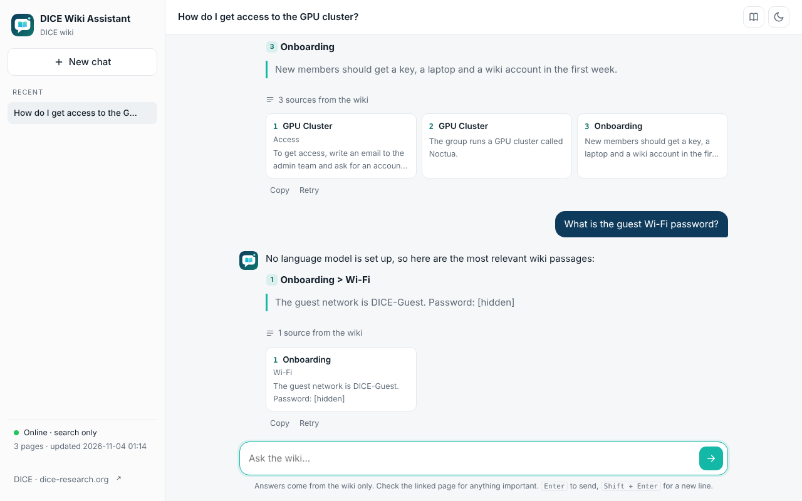

<p align="center">
  
</p>

# WikiChat

**Chat with your MediaWiki.** Self-hosted, private by default, answers with links to the source pages.
Built by the [DICE Research Group](https://dice-research.org) at Paderborn University.

[](https://github.com/dice-group/dice-wiki-chat/actions/workflows/ci.yml)




WikiChat downloads every page of a [MediaWiki](https://www.mediawiki.org) through its API, builds a local
search index, and lets people ask questions in plain language. Answers are written by the language model
of your choice and always cite the wiki pages they come from.

It works with any MediaWiki: public or behind a login, in any language (German and English tested).

## Features

- **Any MediaWiki**: finds `api.php` on its own, crawls all pages of the namespaces you pick
- **Fast updates**: later crawls only download pages that changed
- **Good search**: BM25 keyword search, plus optional multilingual embeddings (fused with reciprocal rank fusion)
- **Sources everywhere**: numbered citations that link to the exact wiki section
- **Any LLM**: a local model with Ollama (nothing leaves your machine), OpenAI, Anthropic, or any OpenAI-compatible server. Or no LLM at all (search only)
- **Private by default**: secrets live in the system keychain, passwords in the wiki are hidden before indexing, the UI only listens on your own computer unless you set a password
- **Simple UI**: streaming answers, saved chats (in your browser), light and dark mode, works on phones, no CDN or tracking
- **Your brand**: name, logo, accent color, welcome text and example questions are all settings

## Contents

- [Quick start](#quick-start)
- [Use it with your own wiki](#use-it-with-your-own-wiki)
- [Choose a language model](#choose-a-language-model)
- [Run the model on a server or VM](#run-the-model-on-a-server-or-vm)
- [Branding](#branding)
- [Security and privacy](#security-and-privacy)
- [Deployment](#deployment)
- [All settings](#all-settings)
- [Commands](#commands)
- [How it works](#how-it-works)
- [Development](#development)

## Quick start

You need Python 3.10 or newer.

```bash
git clone https://github.com/dice-group/dice-wiki-chat.git
cd dice-wiki-chat
python3 -m venv .venv
source .venv/bin/activate          # Windows: .venv\Scripts\activate
python -m pip install -e .
cp .env.example .env               # then edit .env (at least WIKICHAT_WIKI_URL)
```

On macOS you can also run `scripts/setup.sh`, which does all of the above.

```bash
wikichat login      # only if the wiki needs a login (saved in the system keychain)
wikichat check      # tests the connection, shows the page count
wikichat crawl      # downloads the wiki and builds the index
wikichat serve      # opens on http://127.0.0.1:8000
wikichat doctor     # checks your setup for security mistakes
```

## Use it with your own wiki

Only three things are specific to a wiki. Set them in `.env`:

```ini
WIKICHAT_WIKI_URL=https://wiki.example.org/Main_Page   # any page of the wiki
WIKICHAT_NAMESPACES=0                                   # 0 = articles. Add 4, 14, ... if needed
WIKICHAT_BOT_NAME=Example Wiki Assistant
```

If `wikichat check` cannot find the API, also set `WIKICHAT_WIKI_API_URL`
(often `https://wiki.example.org/api.php` or `https://wiki.example.org/w/api.php`).

### Login

Public wikis need no login. For private wikis there are two options:

| Option | When | How |
| --- | --- | --- |
| **Bot password** (best) | The wiki allows normal MediaWiki logins | Create one at `Special:BotPasswords` with "read" rights only, then `wikichat login` and choose 1. The user name looks like `YourName@wikichat`. |
| **Browser cookie** | The wiki uses single sign-on (Shibboleth, SAML, ...) | Log in with your browser, open the developer tools, Network tab, click the page request, copy the value of the `Cookie` request header, then run `wikichat login --clipboard`. Cookies expire, so repeat this when `check` says you are a guest. |

Both are stored in the system keychain (macOS Keychain, Windows Credential Manager, Linux Secret Service),
never in a file. On servers without a keychain, use environment variables (see [Deployment](#deployment)).

Several wikis on one machine? Give each its own folder and `.env`, and set a different
`WIKICHAT_KEYRING_SERVICE` environment variable for each so their logins stay apart.

### Keep pages out

```ini
WIKICHAT_EXCLUDE_TITLES=^(Passwords|Admin/.*)$     # regular expression on page titles
WIKICHAT_EXCLUDE_CATEGORIES=Confidential,Intern     # pages in these categories are never stored
```

### Keep the index fresh

Crawls are incremental, so a nightly job is cheap:

```cron
0 3 * * *  cd /path/to/dice-wiki-chat && .venv/bin/wikichat crawl
```

On macOS, `scripts/service.sh install --crawl` runs the server in the background and crawls every night at 03:00.
Restart the server after a crawl to load the new index.

## Choose a language model

| Provider | Settings in `.env` | Wiki text leaves your machine? |
| --- | --- | --- |
| Search only | `WIKICHAT_LLM_PROVIDER=none` | No |
| [Ollama](https://ollama.com) (local) | `WIKICHAT_LLM_PROVIDER=openai`<br>`WIKICHAT_LLM_BASE_URL=http://localhost:11434/v1`<br>`WIKICHAT_LLM_MODEL=llama3.1` | No |
| OpenAI-compatible server (vLLM, LM Studio, a university endpoint) | `openai` + your `WIKICHAT_LLM_BASE_URL` | To that server |
| OpenAI | `openai` + model, then `wikichat set-key` | Yes |
| Anthropic | `anthropic` + model, then `wikichat set-key` | Yes |

For an internal wiki, a local model or a server inside your network is the safe choice.

### Which open model to use

All of these are open-weight models. Pick by the memory you have (GPU memory on a server, unified memory on a Mac).

| Memory | Model (Ollama name / Hugging Face name) | Notes |
| --- | --- | --- |
| 8 GB | `qwen3:4b` / `Qwen/Qwen3-4B-Instruct-2507` | Laptop or CPU only. Fine for simple questions |
| 16 GB | `qwen3:8b`, `gpt-oss:20b` / `openai/gpt-oss-20b` | Good start on a Mac. Both Apache 2.0 |
| 24 GB | `qwen3:30b-a3b` / `Qwen/Qwen3-30B-A3B-Instruct-2507-FP8` | Fast: only a small part of the model runs per word |
| 24-48 GB | `qwen3.8:27b` | Strong reasoning, 256K context. Turn thinking off (see below) |
| 80 GB | `gpt-oss:120b` / `openai/gpt-oss-120b` | Very strong and still fast for its size |

- Keep `WIKICHAT_LLM_TEMPERATURE` low (0.1). A wiki bot should understand freely but stick to the facts.
- Bigger is not always better. Test with 20 real questions from your users before you decide.
- Check each model's license before you use it outside research.

### Better search with embeddings (optional)

```bash
python -m pip install -e ".[embeddings]"
echo "WIKICHAT_USE_EMBEDDINGS=true" >> .env
wikichat index
```

The default model (`paraphrase-multilingual-MiniLM-L12-v2`) handles 50+ languages and runs on a CPU.

## Run the model on a server or VM

WikiChat itself is light (2 CPUs and 4 GB RAM are enough). Only the language model needs a GPU.
A common setup is two machines inside your network: a small VM for WikiChat, and a GPU server for the model.

```
users ──HTTPS──► WikiChat VM (port 8000, password or SSO) ──private network──► GPU server (model, port 8001)
```

### Option A: Ollama (simple, good for a small team)

On the GPU server:

```bash
curl -fsSL https://ollama.com/install.sh | sh
ollama pull qwen3:30b-a3b
```

Ollama has no login of its own. Either run WikiChat on the same machine (then nothing changes,
`http://localhost:11434/v1` keeps working), or let Ollama listen on the private network and block
everyone except the WikiChat VM:

```bash
sudo systemctl edit ollama          # add the two lines below, save
#   [Service]
#   Environment="OLLAMA_HOST=0.0.0.0:11434"
sudo systemctl restart ollama
sudo ufw allow from <wikichat-vm-ip> to any port 11434 proto tcp
sudo ufw deny 11434
```

In WikiChat's `.env`:

```ini
WIKICHAT_LLM_PROVIDER=openai
WIKICHAT_LLM_BASE_URL=http://<gpu-server>:11434/v1
WIKICHAT_LLM_MODEL=qwen3:30b-a3b
```

### Option B: vLLM (fast for many users at the same time)

[vLLM](https://docs.vllm.ai) serves many requests in parallel, so it stays fast when the whole group uses the bot.
It needs an NVIDIA GPU and Docker with the NVIDIA container toolkit.

```bash
export VLLM_API_KEY=$(openssl rand -hex 32)     # keep this, WikiChat needs it
docker run -d --name vllm --gpus all --restart unless-stopped \
  -p 8001:8000 -v ~/.cache/huggingface:/root/.cache/huggingface \
  vllm/vllm-openai:latest \
  --model Qwen/Qwen3-30B-A3B-Instruct-2507-FP8 \
  --api-key "$VLLM_API_KEY" --max-model-len 32768
sudo ufw allow from <wikichat-vm-ip> to any port 8001 proto tcp
```

The first start downloads the model (about 30 GB). Then, on the WikiChat VM:

```ini
WIKICHAT_LLM_PROVIDER=openai
WIKICHAT_LLM_BASE_URL=http://<gpu-server>:8001/v1
WIKICHAT_LLM_MODEL=Qwen/Qwen3-30B-A3B-Instruct-2507-FP8
```

and save the key with `wikichat set-key` (or `WIKICHAT_LLM_API_KEY` on a server without keychain).

Other models: swap the `--model` value, for example `openai/gpt-oss-20b` (16 GB) or `openai/gpt-oss-120b` (80 GB).

### Turn off "thinking"

Some models (for example `qwen3.8`, `qwen3` in Ollama) think step by step before answering. That costs time
and adds little for a wiki bot. `WIKICHAT_LLM_EXTRA_BODY` adds fields to every request to the model server.
The exact field depends on the server and its version, so check its docs. Common ones:

```ini
# Ollama
WIKICHAT_LLM_EXTRA_BODY={"think": false}
# vLLM with a Qwen thinking model
WIKICHAT_LLM_EXTRA_BODY={"chat_template_kwargs": {"enable_thinking": false}}
```

The `-Instruct-2507` Qwen models above do not think, so they need nothing.

### Run WikiChat on a Linux VM

```bash
sudo useradd --create-home wikichat && sudo -iu wikichat
git clone https://github.com/dice-group/dice-wiki-chat.git && cd dice-wiki-chat
python3 -m venv .venv && .venv/bin/pip install -e .
cp .env.example .env && chmod 600 .env    # set the wiki, model and WIKICHAT_ACCESS_PASSWORD
.venv/bin/wikichat crawl
```

`/etc/systemd/system/wikichat.service`:

```ini
[Unit]
Description=WikiChat
After=network-online.target

[Service]
User=wikichat
WorkingDirectory=/home/wikichat/dice-wiki-chat
ExecStart=/home/wikichat/dice-wiki-chat/.venv/bin/wikichat serve
Restart=on-failure
NoNewPrivileges=true
ProtectSystem=strict
ReadWritePaths=/home/wikichat/dice-wiki-chat/data

[Install]
WantedBy=multi-user.target
```

```bash
sudo systemctl enable --now wikichat
# nightly crawl as the wikichat user (crontab -e):
# 0 3 * * * cd ~/dice-wiki-chat && .venv/bin/wikichat crawl && sudo systemctl restart wikichat
```

Put nginx or Apache with HTTPS in front (see [Behind a reverse proxy](#behind-a-reverse-proxy)).

### No GPU at all?

Many universities can use a hosted, OpenAI-compatible model service run by an academic data center
(in Germany for example the GWDG "Chat AI" API). Set `WIKICHAT_LLM_BASE_URL` and the model name
from that service, and save its key with `wikichat set-key`. Check first that your wiki content may be sent there.

## Branding

```ini
WIKICHAT_BOT_NAME=DICE Wiki Assistant
WIKICHAT_ORG_NAME=DICE
WIKICHAT_ORG_URL=https://dice-research.org
WIKICHAT_ORG_LOGO_FILE=branding/org-logo.svg        # .svg, .png, .jpg or .webp
WIKICHAT_ACCENT_COLOR=#14b8a6
WIKICHAT_WELCOME_TITLE=Hi, what would you like to know?
WIKICHAT_WELCOME_TEXT=I search every page of the DICE wiki and answer with links to the sources.
WIKICHAT_SUGGESTIONS=How do I get GPU access?|Wie beantrage ich eine Dienstreise?
```

The organization name and logo appear at the bottom of the sidebar and link to your website.
Put your logo files in `branding/` (that folder is yours: it is not part of the package).

The WikiChat logo itself is in `src/wikichat/static/brand/` (`logo.svg`, `favicon.svg`, `wordmark.svg`).
Colors and spacing are CSS variables at the top of `src/wikichat/static/app.css`.

## Security and privacy

An internal wiki often holds things that should never show up in a chat window. WikiChat is built with that in mind.

**Secrets never touch the repository**
- Wiki login, LLM key and UI password go to the system keychain (`wikichat login`, `set-key`, `set-password`).
- `.env` and `data/` (the downloaded wiki) are in `.gitignore`. `wikichat doctor` warns if either is tracked by git.
- CI runs [gitleaks](https://github.com/gitleaks/gitleaks) on every push. You can run the same check before each commit:
  `pip install pre-commit && pre-commit install`.

**Secrets in the wiki are hidden**
- Before indexing, values next to words like *password, Passwort, Kennwort, PIN, Türcode, token, API key*,
  plus private keys, passwords inside URLs and common token formats (GitHub, GitLab, OpenAI, AWS, Slack, Google, JWT)
  are replaced with `[hidden]`. The model cannot repeat what it never sees.
- The model is also told never to give out secrets, and to treat wiki text as data, not as instructions.
- Turn this off only if you know what you are doing: `WIKICHAT_REDACT_SECRETS=false`.
- Whole pages or categories can be excluded (see [Keep pages out](#keep-pages-out)).

**The web UI is closed by default**
- It listens on `127.0.0.1` only. To open it to a network, first set a password (`wikichat set-password`);
  otherwise `wikichat serve` refuses to start.
- Strict security headers (Content Security Policy, no framing, no referrer), no API docs page, no external
  fonts or scripts, no server banner.
- Size limits on every request and a rate limit per visitor (`WIKICHAT_RATE_LIMIT_PER_MINUTE`).
- Error details stay in the server log and never reach the browser. Known secret values are masked in logs.
- Downloaded wiki content is stored in a folder only your user can read.
- Chat history is saved in the browser of each user, never on the server.

See [SECURITY.md](SECURITY.md) for how to report a problem.

## Deployment

### Docker

```bash
docker build -t wikichat .
docker run --rm --env-file .env -v "$PWD/data:/data" wikichat wikichat crawl
docker run -d --name wikichat --env-file .env -v "$PWD/data:/data" -p 127.0.0.1:8000:8000 \
  -e WIKICHAT_ACCESS_PASSWORD='a long random password' wikichat
```

Docker has no keychain, so pass secrets as environment variables
(`WIKICHAT_WIKI_PASSWORD`, `WIKICHAT_WIKI_COOKIE`, `WIKICHAT_LLM_API_KEY`, `WIKICHAT_ACCESS_PASSWORD`),
for example from a file that only root can read, or from your platform's secret store.
The container runs as a normal user, not root.

### Behind a reverse proxy

For a team server, put WikiChat behind nginx, Caddy or Apache with HTTPS and your single sign-on, and
keep it on `127.0.0.1`. If the proxy already asks for a login, you may set `WIKICHAT_ALLOW_OPEN=true`
instead of a password. Turn off response buffering for `/api/chat` (`proxy_buffering off;` in nginx)
so answers stream.

## All settings

Every setting can be an environment variable or a line in `.env`. See [.env.example](.env.example) for a commented template.

| Setting | Default | Meaning |
| --- | --- | --- |
| `WIKICHAT_WIKI_URL` | | Any page of the wiki (required) |
| `WIKICHAT_WIKI_API_URL` | auto | Path to `api.php` |
| `WIKICHAT_WIKI_PAGE_URL` | from API | Link pattern for pages, `{title}` is replaced |
| `WIKICHAT_NAMESPACES` | `0` | Namespaces to crawl, comma-separated |
| `WIKICHAT_REQUEST_DELAY` | `0.3` | Seconds between wiki requests |
| `WIKICHAT_EXCLUDE_TITLES` | | Regex of page titles to skip |
| `WIKICHAT_EXCLUDE_CATEGORIES` | | Categories to skip, comma-separated |
| `WIKICHAT_REDACT_SECRETS` | `true` | Hide passwords, keys and tokens found in wiki text |
| `WIKICHAT_DATA_DIR` | `data` | Where pages and the index are stored |
| `WIKICHAT_CHUNK_SIZE` / `_OVERLAP` | `900` / `150` | Passage size in characters |
| `WIKICHAT_USE_EMBEDDINGS` | `false` | Add semantic search |
| `WIKICHAT_TOP_K` | `6` | Passages given to the model |
| `WIKICHAT_LLM_PROVIDER` | `none` | `none`, `openai` (any compatible API) or `anthropic` |
| `WIKICHAT_LLM_BASE_URL` | OpenAI | API address |
| `WIKICHAT_LLM_MODEL` | `gpt-4o-mini` | Model name |
| `WIKICHAT_LLM_TEMPERATURE` / `_MAX_TOKENS` | `0.1` / `1024` | Generation settings |
| `WIKICHAT_LLM_EXTRA_BODY` | | Extra JSON fields for the model server, e.g. `{"think": false}` |
| `WIKICHAT_HOST` / `WIKICHAT_PORT` | `127.0.0.1` / `8000` | Where the UI listens |
| `WIKICHAT_ACCESS_PASSWORD` | | UI password (prefer `wikichat set-password`) |
| `WIKICHAT_ALLOW_OPEN` | `false` | Allow a public address without password |
| `WIKICHAT_RATE_LIMIT_PER_MINUTE` | `20` | Chat and search requests per visitor, `0` = off |
| `WIKICHAT_BOT_NAME`, `_ORG_NAME`, `_ORG_URL`, `_ORG_LOGO_FILE`, `_ACCENT_COLOR`, `_WELCOME_TITLE`, `_WELCOME_TEXT`, `_SUGGESTIONS` | | [Branding](#branding) |
| `WIKICHAT_KEYRING_SERVICE` | `wikichat` | Keychain name (environment variable only) |

## Commands

| Command | What it does |
| --- | --- |
| `wikichat check` | Test the connection and login |
| `wikichat login [--clipboard]` | Save the wiki login in the keychain |
| `wikichat set-key` | Save the LLM API key in the keychain |
| `wikichat set-password` | Protect the web UI with a password |
| `wikichat logout` | Remove all saved secrets |
| `wikichat crawl [--full]` | Download pages and rebuild the index |
| `wikichat index` | Rebuild the index only |
| `wikichat search "query"` | Show the best passages |
| `wikichat ask "question"` | Ask one question in the terminal |
| `wikichat serve` | Start the web UI |
| `wikichat doctor` | Check the setup for security mistakes |

## How it works

```
MediaWiki API ──► crawler ──► data/pages.jsonl ──► chunker + redaction ──► BM25 (+ embeddings) index
                                                                                   │
browser ◄── streamed answer + sources ◄── LLM ◄── top passages ◄── search ◄────────┘
```

## Development

```bash
python -m pip install -e ".[dev]"
pytest -q          # uses a fake wiki, no network needed
ruff check .
pip-audit          # known vulnerabilities in dependencies
```

Contributions are welcome, see [CONTRIBUTING.md](CONTRIBUTING.md).

## License

[MIT](LICENSE). Bundled: [marked](https://github.com/markedjs/marked) (MIT) and
[DOMPurify](https://github.com/cure53/DOMPurify) (Apache 2.0 / MPL 2.0).
